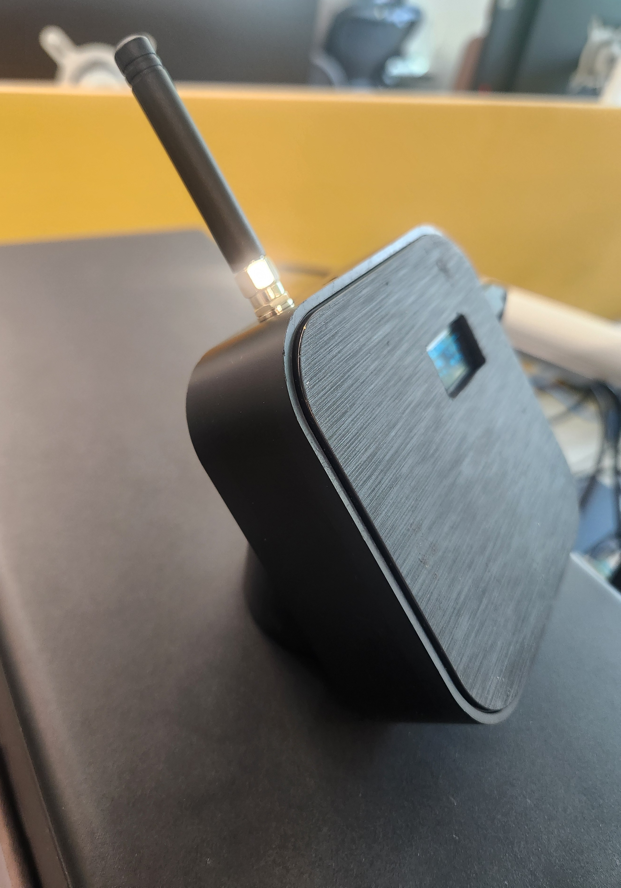
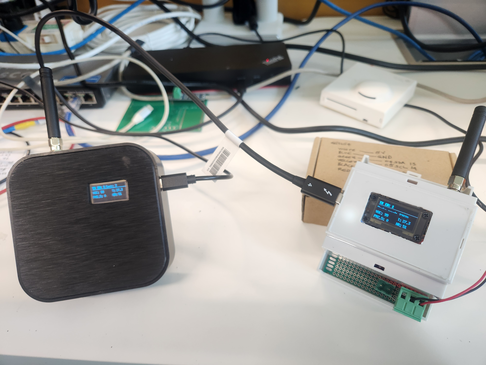
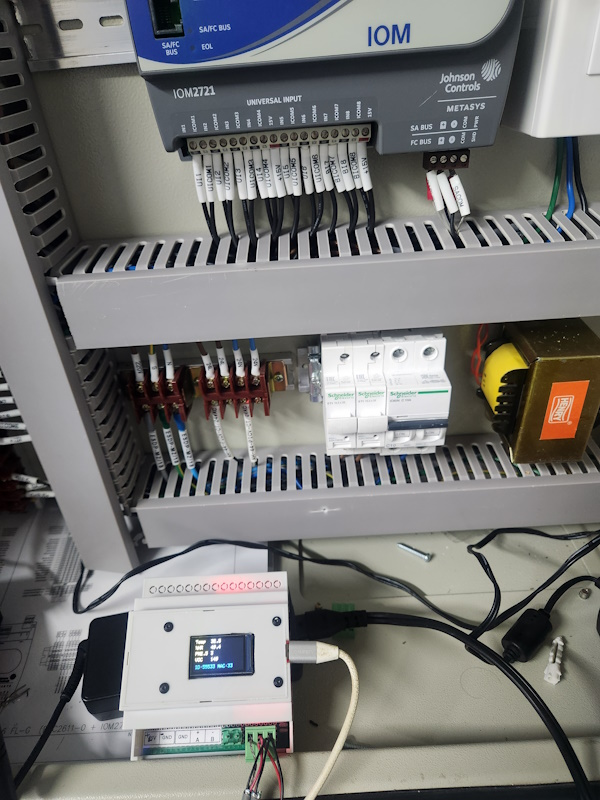
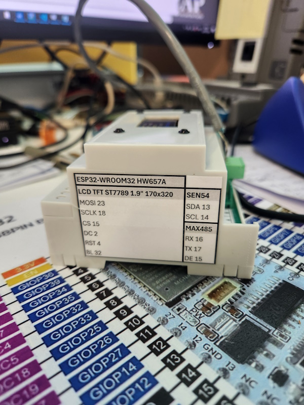

# ESP32-S3 LoRa BACnet Gateway

LoRa-to-BACnet gateway firmware for the Heltec WiFi LoRa 32 V4 board using the SX1262 radio and a 128x64 SSD1315 OLED. The gateway receives validated LoRa sensor packets and publishes the resulting values into the BACnet object model while keeping BACnet/IP and BACnet MS/TP services active.

The project is optimized for the gateway use case. BACnet identity, transport
settings, object defaults, and persistence configuration are defined in
`main/User_Settings.c`; object counts and the LoRa timeout are defined in
`main/User_Settings.h`.

## 📡 Features

* BACnet/IP over Wi-Fi
* BACnet MS/TP over RS485
* BACnet Change of Value (`COV`)
* LoRa packet receive/validation path for fixed-size sensor payloads
* LoRa-to-BACnet bridge into BACnet analog objects
* SSD1315 OLED status display for received packets and latest values
* NVS persistence for writable BACnet properties
* Runtime-configurable object names, descriptions, units, and COV increments
* Full BACnet Device identity
* Startup settings report and FreeRTOS stack monitoring
* Private credentials excluded from source control

## 🎛️ Gateway build selection

Use the ESP-IDF target selection normally, then select the hardware/display
profile in Menuconfig:

```text
ESP-IDF: Set Espressif Device Target
ESP-IDF: SDK Configuration Editor
Project hardware
└── Display profile
    └── LoRa 32 V4 SX1262 gateway receiver
```

Hardware profiles are configurable at compile time. The profile selection is
the integration point for other processor boards, displays, and display
drivers; a profile can provide its own GPIO mapping, UI, and optional
peripherals. The active project configuration includes the LoRa gateway
profile, and additional profiles can be added to the same Menuconfig choice.

After changing the target or GPIO mapping, run a full clean build.

### Gateway OLED

The gateway profile uses the Heltec board's 128x64 SSD1315 OLED over I2C. The
display is blank until the first accepted LoRa packet. For transmitter IDs 1–4,
it then shows the most recently accepted packet:

```text
RECEIVED: <count>
Device ID: <device id>
VOC: <value>       T: <temperature>
PM2.5: <value>     HR: <humidity>
```

For IDs 5–6, the measurement labels are `A1`–`A4` instead. When the displayed
transmitter times out, all four values change to `-1`; its ID and the received
packet count stay unchanged. A timeout for another transmitter does not replace
the current screen. The next accepted packet updates the display and increments
the count.

The current wiring and bus settings are:

| Signal | GPIO or value |
| ------ | ------------- |
| I2C address | `0x3C` |
| SDA | `17` |
| SCL | `18` |
| OLED reset | `21` |
| OLED VEXT | `36` |
| I2C speed | `400 kHz` |

The display implementation is in
[`main/ui/profiles/display_lora_gateway.c`](main/ui/profiles/display_lora_gateway.c).

## 📊 BACnet Object Model

The gateway accepts transmitter IDs 1–6 and exposes 24 BACnet Analog Input
application objects, four per transmitter. AV, BV, BI, and BO defaults are
retained for future use, but those objects are not currently created.

| Objects     | Default purpose                                           |
| ----------- | --------------------------------------------------------- |
| `AI1`–`AI16`  | IDs 1–4: temperature, relative humidity, VOC index, PM2.5 |
| `AI17`–`AI20` | ID 5: generic inputs 1–4, no units                       |
| `AI21`–`AI24` | ID 6: generic inputs 1–4, no units                       |

These are logical default roles. BACnet instance numbers, names, descriptions, units, initial values, COV increments, and binary text are configurable through the parallel arrays in `main/User_Settings.c`.

Before a transmitter's first valid packet, its four values are `-1` without a
fault. After a transmitter has been seen, a gap of
`USER_LORA_TIMEOUT_SECONDS` (currently 60 seconds in `main/User_Settings.h`)
sets its values to `-1` and
its BACnet reliability to communication failure. A new valid packet clears the
fault, even if its readings have not changed. BACnet clients must be configured
to alert on the fault; `-1` can also be a valid sensor reading. After receiver
restart, each transmitter is treated as unseen until it sends a valid packet.

IDs 5–6 use the same packet format: their generic inputs 1–4 correspond to the
temperature, humidity, VOC, and PM2.5 packet fields, respectively, and must be
finite. Existing NVS-saved BACnet names, descriptions, units and COV increments
override compiled defaults; update saved metadata if it reflects an older
mapping, especially ID 2's former dissolved-oxygen point. See
[`OBJECTS_CONFIGURATION.md`](OBJECTS_CONFIGURATION.md).

## ⚙️ Configuration

### Public settings

Edit:

```text
main/User_Settings.c
main/User_Settings.h
```

These files contain:

* BACnet Device identity and instance;
* BACnet/IP and MS/TP enable flags;
* static IP and BBMD settings;
* MS/TP MAC address, baud rate, Max Master, and Max Info Frames;
* BACnet object instances and metadata;
* NVS default-restoration policy.

### Private credentials

Copy:

```text
main/User_Private_Settings.example.h
```

to:

```text
main/User_Private_Settings.h
```

Then enter the Wi-Fi and, when required, Adafruit IO credentials. The private file is ignored by Git.

## 🚀 Build

Tested environment:

* ESP-IDF `6.0.2`
* Visual Studio Code with the ESP-IDF extension
* Git

The supplied PowerShell wrapper verifies the ESP-IDF installation before running `idf.py`:

```powershell
powershell -NoProfile -ExecutionPolicy Bypass `
    -File .\tools\build_idf60.ps1 build
```

After changing a display profile or TFT_eSPI setup:

```powershell
powershell -NoProfile -ExecutionPolicy Bypass `
    -File .\tools\build_idf60.ps1 fullclean

powershell -NoProfile -ExecutionPolicy Bypass `
    -File .\tools\build_idf60.ps1 build
```

Flash and monitor using the ESP-IDF extension or the corresponding wrapper arguments.

See [`SETUP.md`](SETUP.md) for the complete environment, configuration, build, and flashing procedure.

## 🌐 Validation and Commissioning

Use YABE (Yet Another BACnet Explorer) to discover the device with `Who-Is`, inspect
its BACnet objects, write supported properties, and verify Change of Value (`COV`)
notifications. BACnet/IP uses the standard UDP port `47808` (`0xBAC0`), which can
also be inspected with Wireshark when troubleshooting network communication.

For BACnet MS/TP installations, use a daisy-chain RS485 layout, verify the selected
baud rate and MAC settings, and install 120-ohm termination only at the two physical
ends of the bus. Avoid frequent automated writes to NVS-backed properties because
unnecessary flash writes can reduce storage lifetime.

## 💾 Persistence

Supported BACnet object properties and sensor configuration values are stored in NVS.

Normal operation:

```c
USER_OVERRIDE_NVS_ON_FLASH = 0;
```

To erase saved values and restore compiled defaults on the next boot:

```c
USER_OVERRIDE_NVS_ON_FLASH = 1;
```

After restoring the defaults, return the setting to `0`; otherwise NVS will be erased at every startup.

## 📜 Documentation

* [`SETUP.md`](SETUP.md) — environment, configuration, build, and flashing
* [`docs/profiles/`](docs/profiles/) — supported hardware/display profiles and wiring
* [`docs/DISPLAY_HARDWARE_PROFILES_GUIDE.md`](docs/DISPLAY_HARDWARE_PROFILES_GUIDE.md) — adding and maintaining profiles
* [`OBJECTS_CONFIGURATION.md`](OBJECTS_CONFIGURATION.md) — BACnet object configuration and NVS persistence

The legacy [`Profiles.md`](Profiles.md) file redirects to the profile documentation folder.

## 📂 Source Layout

```text
main/
├── app/                 Application services and gateway coordination
│   └── sensors/         Legacy auxiliary sensor services (disabled in the gateway profile)
├── bacnet/              BACnet runtime, coordinator, event bus, and objects
│   └── objects/         AI, AV, BI, BV, and BO implementations
├── platform/            Wi-Fi and MS/TP RS485 interfaces
├── ui/
│   ├── hardware/        Profile-specific touch/display support
│   └── profiles/        Selectable display/UI implementations
├── User_Settings.c      Device and BACnet configuration
├── User_Settings.h      Object counts and logical role definitions
└── main.c               Application startup
```

## Screenshots










